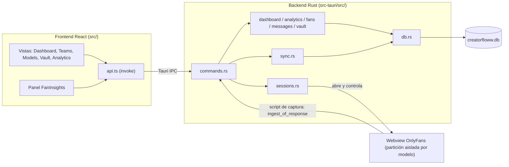

# CreatorFloww

> CRM de escritorio para agencias de OnlyFans: modelos, equipo, turnos, mensajes, insights de fans, vault y analytics en una sola aplicación.

**CreatorFloww** es una aplicación de escritorio (Windows) construida con **Tauri v2 + React**. La usan administradores y *chatters* de una agencia para gestionar las cuentas de sus modelos, registrar empleados y turnos, trabajar los chats de OnlyFans con un panel de información del fan, y analizar las ganancias.

> [!NOTE]
> La carpeta del repositorio se llama `ChatterFlow`, pero el nombre del producto (ejecutable, instalador, base de datos e identificador `com.creatorfloww.app`) es **CreatorFloww**.

---

## Índice

1. [Funcionalidades](#funcionalidades)
2. [Stack tecnológico](#stack-tecnológico)
3. [Arquitectura](#arquitectura)
4. [Requisitos e instalación](#requisitos-e-instalación)
5. [Scripts disponibles](#scripts-disponibles)
6. [Estructura del proyecto](#estructura-del-proyecto)
7. [Descripción de cada carpeta y archivo](#descripción-de-cada-carpeta-y-archivo)
8. [Base de datos](#base-de-datos)
9. [Reglas del proyecto](#reglas-del-proyecto)

---

## Funcionalidades

| Sección | Qué hace |
|---|---|
| **Dashboard** | Resumen de ganancias por canal (Subscriptions, Posts, Messages, Tips, Referrals, Streams) en bruto o neto, para Ayer / Hoy / Esta semana / Este mes. Muestra *Mis turnos*, *Empleados activos* y *Ventas por empleado*. |
| **Equipos y Roles** | Alta, edición y baja de empleados con rol (`Owner`, `Admin`, `Chatter`, `Dropper`) y horario semanal. *Clock in* / *Clock out* para abrir y cerrar turnos. |
| **Modelos** | Lista de cuentas de modelos. Cada modelo abre su propia ventana de OnlyFans en una **partición WebView aislada** con inicio de sesión optimizado, autodetección inmediata del perfil/balance al autenticar y reutilización inteligente de particiones pendientes. Permite abrir chats, sincronizar datos y eliminar la cuenta. |
| **Messages** | Ventana compartida con selector de cuentas intercambiable entre **barra superior** y **barra lateral**, chat real de OnlyFans y panel **Fan Insights** (gasto, métricas, suscripción, info personal, listas, notas, PPV timeline y scripts). |
| **Notificaciones** | Cada cuenta autenticada se escucha en segundo plano, aunque no esté seleccionada y aunque estés en Dashboard, Modelos u otra vista. Un mensaje nuevo dispara un toast nativo de Windows (también sin foco), un aviso in-app, sonido opcional y un badge de no leídos en el selector. Las ráfagas del mismo fan se agrupan. El clic abre esa cuenta y esa conversación. PPV y propinas siguen avisando en verde. El dedupe y los no leídos viven en SQLite. |
| **Vault** | Navega por el contenido multimedia del vault de cada modelo y permite descargarlo a una carpeta local. |
| **Analytics** | Gráficos de tendencia, desglose por canal y por creador (24 h, 7/30/90/180 días, histórico) con agrupación por hora/día/semana/mes. Exporta a **CSV, Excel (.xlsx) o PDF**. |

Además: modo claro/oscuro (se guarda en `localStorage`) e instalador NSIS para Windows.

---

## Stack tecnológico

| Capa | Tecnología |
|---|---|
| Shell de escritorio | [Tauri v2](https://tauri.app) (WebView2 en Windows), `tauri-plugin-notification` (toasts nativos) |
| Backend | Rust 2021 (≥ 1.95), `tokio`, `reqwest` (rustls), `serde`, `chrono` |
| Base de datos | SQLite embebida con `rusqlite` (feature `bundled`) |
| Exportación | `rust_xlsxwriter` (Excel), CSV y PDF propios, `rfd` (diálogos nativos de archivo) |
| Frontend | React 19 + TypeScript (modo `strict`) |
| Build web | Vite 8 + `@vitejs/plugin-react` |
| Estilos | Tailwind CSS 4 (`@tailwindcss/vite`) + tokens CSS propios, fuente Satoshi |
| UI | `lucide-react` (iconos), `recharts` (gráficos) |
| Instalador | NSIS (vía `tauri build`) |

---

## Arquitectura



**Flujo de datos:**

1. El frontend React llama a los comandos de Rust con `invoke()` (todos están en `src/api.ts` o se llaman directamente desde los componentes).
2. `commands.rs` recibe la llamada y la delega en el módulo correspondiente, que lee o escribe en SQLite mediante `db.rs`.
3. Al abrir una modelo, `sessions.rs` crea una webview de `onlyfans.com` con su propio directorio de datos (`partitions/<partition_id>`) y le inyecta un **script de captura**.
4. Ese script reenvía las respuestas de la API de OnlyFans al comando `ingest_of_response`. `sync.rs` las clasifica (perfil, ganancias, fans, chats, mensajes, etc.) y las guarda en SQLite con *upsert* por ID real de OnlyFans, para no duplicar datos.
5. La ventana de **Messages** contiene dos webviews: el chat de OnlyFans y una instancia de la propia app en modo `insights` (`window.__CF_VIEW__ === "insights"`), que muestra `FanInsightsPanel` del fan seleccionado.
6. Al arrancar, y otra vez al autenticar una cuenta, `sessions.rs` mantiene **una sesión de OnlyFans por cuenta** (la ventana `model-<id>` si está abierta, o un webview `messages-<id>-of` dentro del hub). Esas sesiones no se ocultan: si Mensajes está cerrado, el hub se aparca fuera de pantalla y cada webview sigue a tamaño real (1100×760) para que OnlyFans arranque y el poll de inbox (cada 1,5 s, más el evento en vivo) siga vivo. Un mensaje nuevo avisa aunque ese chat esté abierto; el badge de no leídos solo se omite en la conversación que ya se está viendo. La primera lectura del inbox no reavisa el historial, pero sí un mensaje de los últimos 3 minutos. `notifications.rs` compara cada mensaje con `account_notify_state` y `notified_events` en SQLite, emite `cf-notification` y muestra el toast de Windows. El clic llama a `open_incoming_chat`, que trae el hub al frente, cambia a esa cuenta y abre `/my/chats/chat/{fan}`.

---

## Requisitos e instalación

**Requisitos**

- [Node.js](https://nodejs.org) (LTS reciente) y npm
- [Rust](https://rustup.rs) ≥ 1.95 (toolchain MSVC en Windows)
- Microsoft Visual Studio C++ Build Tools
- WebView2 Runtime (viene incluido en Windows 10/11)

**Instalación**

```powershell
npm install
```

**Desarrollo** (abre la app de escritorio con recarga en caliente):

```powershell
npm run tauri:dev
```

**Generar el instalador** (`.exe` NSIS copiado a `installer/`):

```powershell
.\scripts\build-installer.ps1
```

---

## Scripts disponibles

Definidos en [`package.json`](package.json):

| Comando | Descripción |
|---|---|
| `npm run dev` | Inicia solo el servidor Vite en `http://127.0.0.1:1420` (frontend sin backend Tauri). |
| `npm run build` | Comprueba los tipos con `tsc --noEmit` y compila el frontend en `dist/`. |
| `npm run preview` | Sirve el build de `dist/` para revisarlo. |
| `npm run tauri` | Acceso directo a la CLI de Tauri (`npm run tauri -- <args>`). |
| `npm run tauri:dev` | Ejecuta la app de escritorio en modo desarrollo. |
| `npm run tauri:build` | Compila en *release* y genera el instalador NSIS. |
| `npm run installer` | Alias de `tauri build`. |
| `npm run icon` | Regenera todos los iconos a partir de `src-tauri/icons/app-icon-source.png`. |

---

## Estructura del proyecto

```text
ChatterFlow/
├── .cursorrules.md            # Reglas obligatorias para asistentes de IA
├── .gitignore                 # Carpetas excluidas del control de versiones
├── PRODUCT.md                 # Brief del producto (usuarios, propósito, principios)
├── README.md                  # Este documento
├── build-installer.log        # Log de la última compilación del instalador
├── index.html                 # HTML de entrada de Vite
├── package.json               # Dependencias y scripts npm
├── package-lock.json          # Versiones exactas de dependencias npm
├── tsconfig.json              # Configuración de TypeScript
├── vite.config.ts             # Configuración de Vite
│
├── scripts/
│   └── build-installer.ps1    # Compila y copia el instalador a installer/
│
├── installer/                 # Instaladores generados (.exe)
│
├── src/                       # Frontend React + TypeScript
│   ├── main.tsx
│   ├── App.tsx
│   ├── api.ts
│   ├── types.ts
│   ├── index.css
│   ├── vite-env.d.ts
│   ├── DashboardView.tsx
│   ├── TeamsView.tsx
│   ├── ModelsView.tsx
│   ├── VaultView.tsx
│   ├── AnalyticsView.tsx
│   ├── FanInsights.tsx
│   └── messages/
│       ├── types.ts
│       ├── ppv/
│       │   └── PpvTimeline.tsx
│       └── scripts/
│           ├── ScriptPopover.tsx
│           └── scriptStore.ts
│
├── src-tauri/                 # Backend Rust + configuración de Tauri
│   ├── Cargo.toml
│   ├── Cargo.lock
│   ├── build.rs
│   ├── tauri.conf.json
│   ├── src/
│   │   ├── main.rs
│   │   ├── lib.rs
│   │   ├── commands.rs
│   │   ├── db.rs
│   │   ├── dashboard.rs
│   │   ├── analytics.rs
│   │   ├── fans.rs
│   │   ├── messages.rs
│   │   ├── sessions.rs
│   │   ├── sync.rs
│   │   └── vault.rs
│   ├── capabilities/
│   │   ├── default.json
│   │   ├── fan-insights.json
│   │   └── model-session.json
│   ├── permissions/autogenerated/   # 31 archivos .toml (uno por comando)
│   ├── gen/schemas/                 # Esquemas JSON generados por Tauri
│   ├── icons/                       # Iconos de la app (Windows, macOS, Android, iOS)
│   ├── nsis/
│   │   └── hooks.nsh
│   └── target/                      # Salida de compilación de Cargo (generada)
│
├── dist/                      # Build del frontend (generado)
└── node_modules/              # Dependencias npm (generado)
```

---

## Descripción de cada carpeta y archivo

### Raíz del proyecto

| Archivo | Descripción |
|---|---|
| `.cursorrules.md` | Contexto y **reglas estrictas** para asistentes de IA (Cursor, etc.): stack, estilo visual, prohibición de datos falsos, *upsert* por ID de OnlyFans, sin proxies y desarrollo por fases. |
| `.gitignore` | Excluye `node_modules/`, `dist/` y `src-tauri/target/`. |
| `PRODUCT.md` | Brief del producto: plataforma, stack, usuarios (admins y chatters), propósito, roles válidos, restricciones, identidad visual y principios (la base local es la única fuente de verdad). |
| `README.md` | Este documento. |
| `build-installer.log` | Salida de la última ejecución de `tauri build` (compilación de Vite y Cargo y empaquetado NSIS). Es solo informativo. |
| `index.html` | Página HTML de entrada que carga Vite. Tiene el `<div id="root">`, carga la fuente **Satoshi** desde Fontshare e importa `src/main.tsx`. |
| `package.json` | Nombre (`creatorfloww`), versión, scripts npm y dependencias del frontend y de la CLI de Tauri. |
| `package-lock.json` | Árbol de dependencias npm con versiones exactas, para instalaciones reproducibles. |
| `tsconfig.json` | Configuración de TypeScript: ES2022, `jsx: react-jsx`, modo `strict`, sin locales ni parámetros sin usar, `moduleResolution: bundler`. Solo incluye `src/`. |
| `vite.config.ts` | Configuración de Vite: plugins React y Tailwind, servidor en `127.0.0.1:1420` (puerto fijo que espera Tauri), `base: "./"` para rutas relativas, prefijos de entorno `VITE_` y `TAURI_`, y target `es2022`. |

### `scripts/`

| Archivo | Descripción |
|---|---|
| `build-installer.ps1` | Script de PowerShell que ejecuta `npm run tauri:build`, busca el `*-setup.exe` generado en `src-tauri/target/release/bundle/nsis/` (o en `CARGO_TARGET_DIR`) y lo copia a `installer/`, indicando la ruta y el tamaño final. |

### `installer/`

Contiene los instaladores ya compilados, por ejemplo `CreatorFloww_0.1.0_x64-setup.exe` (unos 4.7 MiB). Se genera con `scripts/build-installer.ps1`.

---

### `src/` — Frontend (React + TypeScript)

| Archivo | Descripción |
|---|---|
| `main.tsx` | Punto de entrada de React: monta `<App />` dentro de `StrictMode` en `#root` e importa `index.css`. |
| `App.tsx` | Componente raíz. Si la webview se carga en modo *insights* (`window.__CF_VIEW__`), renderiza solo `FanInsightsPanel`. Si no, muestra el **shell** principal: barra lateral con navegación (Dashboard, Equipos y Roles, Modelos, Messages, Vault, Analytics), carril de modelos, selector de modo oscuro y la vista activa. |
| `api.ts` | Capa de acceso al backend: funciones tipadas que envuelven `invoke()` de Tauri (`getEmployees`, `addEmployee`, `toggleClockIn`, `getModels`, `openModelSession`, `deleteModel`, `syncModelData`, `getEarningsOverview`, `getAnalytics`, `exportAnalytics`, etc.), sus tipos de respuesta y `errorMessage()` para normalizar errores. |
| `types.ts` | Tipos compartidos (`Employee`, `EmployeeRole`, `Model`, `ScheduleDay`, `Weekday`), constantes (`ROLES`, `WEEKDAYS`) y utilidades de formato: `formatMoney`, `formatStamp`, `modelLabel`, `initials`, `avatarColor`, `summarizeSchedule`, `scheduleFromJson`, `blankSchedule`. |
| `index.css` | Estilos globales: importa Tailwind, define *design tokens* (variables CSS) para modo claro y oscuro, y clases utilitarias propias (`cf-card`, `cf-btn-primary`, `cf-btn-secondary`, `cf-btn-danger`, `cf-btn-live`, `cf-input`, …). |
| `vite-env.d.ts` | Declaración de tipos de Vite (`/// <reference types="vite/client" />`). |
| `DashboardView.tsx` | Vista **Dashboard**: selector de rango (Ayer/Hoy/Semana/Mes) y base (neto/bruto), totales por canal y paneles *Mis turnos*, *Empleados activos* y *Ventas por empleado*. |
| `TeamsView.tsx` | Vista **Equipos y Roles**: formulario para registrar empleados con rol y horario semanal, lista de *Empleados registrados*, edición de rol y horario, eliminación y botón *Clock in / Clock out*. |
| `ModelsView.tsx` | Vista **Modelos**: tarjetas de cada cuenta con su estado de sesión (*Sin sesión*, *Esperando login*, *Sesión guardada*), saldo y última sincronización. Botones para abrir mensajes, enfocar/abrir la sesión de OnlyFans, sincronizar y eliminar. |
| `MessagesTabBar.tsx` | Selector de cuentas de la ventana compartida de **Messages**, intercambiable en caliente entre **barra superior** y **barra lateral**, con contadores de mensajes sin leer e indicadores verdes de venta. |
| `Notifications.tsx` | Toasts in-app, sonido y centro de historial/preferencias. El push de Windows lo emite Rust; esta vista solo escucha `cf-notification` y, al hacer clic, abre la cuenta y el chat. |
| `VaultView.tsx` | Vista **Vault**: elige una modelo, lista su contenido multimedia del vault de OnlyFans (paginado y filtrado por tipo) y permite descargarlo. |
| `AnalyticsView.tsx` | Vista **Analytics**: tarjetas de métricas con variación porcentual, gráficos Recharts (tendencia, canales, donuts por creador), filtros de rango y agrupación, y exportación a CSV/XLSX/PDF. |
| `FanInsights.tsx` | `FanInsightsPanel`: panel lateral de la ventana de mensajes. Muestra del fan activo: *Comportamiento de gasto*, *Métricas de perfil*, *Suscripción*, *Información personal*, *Listas de OnlyFans*, notas editables, PPV timeline y acceso a scripts. Se actualiza cuando cambia el chat seleccionado. |

### `src/messages/` — Módulo de mensajería

| Archivo | Descripción |
|---|---|
| `types.ts` | Tipos y utilidades del compositor de mensajes: `ComposerDraft`, `EMPTY_DRAFT`, límites de precio de medios (`MEDIA_PRICE_MIN = 3`, `MEDIA_PRICE_MAX = 200`), `applyFanName()` (sustituye el nombre del fan en el texto) y `draftFromScript()`. |
| `ppv/PpvTimeline.tsx` | Componente **PPV timeline**: historial cronológico de los PPV enviados al fan, con precio y si se compraron o no. |
| `scripts/ScriptPopover.tsx` | Ventana emergente para buscar y filtrar (por texto o etiqueta) los **scripts** de mensajes guardados e insertarlos en el chat. |
| `scripts/scriptStore.ts` | *Store* ligero (patrón `subscribe` / `getState` / `setState`) que guarda el estado de los scripts: filtro, paginación y carga desde el backend (`loadScripts`, `setScriptFilter`, `resetScriptStore`). |

---

### `src-tauri/` — Backend (Rust) y configuración de Tauri

| Archivo | Descripción |
|---|---|
| `Cargo.toml` | Manifiesto del *crate* Rust `creatorfloww`: librería `creatorfloww_lib` y dependencias (`tauri`, `tauri-plugin-notification`, `rusqlite`, `tokio`, `reqwest`, `serde`, `chrono`, `rfd`, `rust_xlsxwriter`). |
| `Cargo.lock` | Versiones exactas de las dependencias Rust. |
| `build.rs` | Script de compilación: llama a `tauri_build` y declara el **manifiesto de comandos** de la app, que genera los permisos de `permissions/autogenerated/`. |
| `tauri.conf.json` | Configuración de Tauri: nombre, versión, identificador `com.creatorfloww.app`, comandos de dev/build, ventana principal (1280×800), CSP e instalador **NSIS** (instalación por máquina, idiomas inglés y español, iconos y hooks). |

### `src-tauri/src/` — Código Rust

| Archivo | Descripción |
|---|---|
| `main.rs` | Ejecutable: oculta la consola en *release* (`windows_subsystem = "windows"`) y llama a `creatorfloww_lib::run()`. |
| `lib.rs` | Arranque de la app: declara los módulos, inicializa la base de datos, registra `tauri-plugin-notification` y el estado compartido (`Database`, `SyncBus`, `NotificationBus`), arranca los monitores de todas las cuentas autenticadas y registra los comandos IPC. |
| `commands.rs` | **Capa de comandos Tauri** (`#[tauri::command]`): son los puntos de entrada que llama el frontend. Validan parámetros y delegan en `db`, `dashboard`, `analytics`, `fans`, `messages`, `sessions`, `sync` y `vault`. Incluye `sync_all_models`, gestión de empleados y modelos, insights, inbox, scripts, PPV, vault e `ingest_of_response`. |
| `db.rs` | **Capa de datos SQLite**: crea `creatorfloww.db`, define el esquema (versión 7) y sus migraciones, los tipos (`Model`, `Employee`, `Shift`, `Fan`, `Transaction`, `FanNote`, `EmployeeRole`, `TransactionType`), el error `DbError` y las operaciones CRUD (empleados, turnos y clock in, modelos y particiones, perfil y saldos de OnlyFans, *upsert* de ganancias). Define `ONLYFANS_NET_RATIO = 0.8` (OnlyFans se queda el 20 %). |
| `dashboard.rs` | Consultas del Dashboard: `earnings_overview` (totales por canal, neto o bruto, por rango), `my_shifts`, `clocked_in_employees` y `employee_sales`. |
| `analytics.rs` | Motor de Analytics: rangos (`AnalyticsRange`), agrupación temporal (`TrendBucket`), métricas, series de tendencia, desglose por canal y por creador (`AnalyticsReport`). También exporta (`export_report`) a CSV, XLSX o PDF con un diálogo nativo para guardar. |
| `fans.rs` | Lógica de fans: arma `FanInsights` (gasto, ventas, suscripción, listas, notas), aplica datos de suscripción y gasto que llegan de OnlyFans, y actualiza el perfil, las notas y las listas del fan. |
| `messages.rs` | Mensajería: inbox de chats (`list_inbox`), hilo de mensajes (`list_thread`), scripts paginados con filtros (`list_scripts`), estado del PPV timeline, envío de mensajes (`send_message`) y sustitución del nombre del fan en el texto. |
| `notifications.rs` | Único motor de avisos. Deduplica en SQLite (`notified_events`, watermark `last_seen_message_id`), persiste no leídos e historial, agrupa ráfagas del mismo fan (8 s) y muestra el toast nativo de Windows. Interpreta WebSocket y HTTP para mensajes, PPV y propinas. |
| `sessions.rs` | **Gestión de sesiones de OnlyFans**, el módulo más grande. Abre o enfoca la ventana de cada modelo (`model-<id>`) con su partición WebView aislada (`partitions/<partition_id>`) optimizada para un login rápido. Mantiene un monitor por cuenta autenticada independiente de la vista activa: si Mensajes se cierra, el hub se aparca fuera de pantalla en lugar de ocultarse. Crea la ventana compartida de **Messages** (barra superior o lateral, webview de OnlyFans y webview de insights). Inyecta la captura HTTP/WebSocket, abre el chat de un fan con `open_incoming_chat` y orquesta la sincronización con `SyncBus`. |
| `sync.rs` | **Ingesta de datos de OnlyFans**: `classify_url` identifica a qué endpoint pertenece cada respuesta capturada (`CaptureKind`) e `ingest_body` / `ingest_observation` la procesan y la guardan en SQLite con *upsert* (perfil, ganancias y transacciones, fans, chats, mensajes, PPV, propinas). Así se evita duplicar métricas. |
| `vault.rs` | Vault de OnlyFans: lista el contenido multimedia paginado (`list_vault_media`, `parse_vault_page`) y lo descarga (`download_vault_media`) a la carpeta que elija el usuario en un diálogo nativo. |

### `src-tauri/capabilities/` — Permisos por ventana

Definen qué comandos IPC puede llamar cada ventana o webview (modelo de seguridad de Tauri v2).

| Archivo | Descripción |
|---|---|
| `default.json` | Permisos de la ventana principal (`main`): casi todos los comandos de la app (empleados, modelos, dashboard, analytics, mensajes, vault, …). |
| `fan-insights.json` | Permisos de las webviews de insights (`messages-*-insights`): leer y editar insights del fan, notas, listas, PPV timeline, scripts e insertar texto en el chat. |
| `model-session.json` | Permisos de las webviews **remotas** de OnlyFans (`model-*`, `messages-*-of`, solo en `https://onlyfans.com/*`): únicamente `ingest_of_response`, `fan_selected` y `download_vault_media`. |

### `src-tauri/permissions/autogenerated/`

Un archivo `.toml` por comando (por ejemplo `get_models.toml`, `open_incoming_chat.toml`, `ingest_of_response.toml`). Tauri los **genera automáticamente** a partir de `build.rs`, y cada uno define los permisos `allow-<comando>` y `deny-<comando>` que usan las *capabilities*. **No deben editarse a mano.** La ventana principal también tiene el permiso `notification:default` del plugin de toasts.

### `src-tauri/gen/schemas/`

Esquemas JSON que genera Tauri (`acl-manifests.json`, `capabilities.json`, `desktop-schema.json`, `windows-schema.json`). Sirven para validar y autocompletar los archivos de `capabilities/`. Se regeneran al compilar.

### `src-tauri/icons/`

Iconos de la aplicación en todos los tamaños y formatos: `icon.ico` (Windows), `icon.icns` (macOS), PNG de varios tamaños, logos `Square*Logo.png` (Microsoft Store), y las subcarpetas `android/` e `ios/`. `app-icon-source.png` es la imagen original desde la que se regeneran todos con `npm run icon`.

### `src-tauri/nsis/`

| Archivo | Descripción |
|---|---|
| `hooks.nsh` | Hooks del instalador NSIS: crea un acceso directo `CreatorFloww.lnk` en el escritorio al instalar y lo borra al desinstalar. |

---

### Carpetas generadas (no se versionan)

| Carpeta | Descripción |
|---|---|
| `node_modules/` | Dependencias npm instaladas con `npm install`. |
| `dist/` | Build del frontend generado por `npm run build`; Tauri lo empaqueta en el ejecutable. |
| `src-tauri/target/` | Artefactos de compilación de Cargo (`debug/`, `release/`, `bundle/nsis/`). Puede ocupar varios GB. |

---

## Base de datos

- **Archivo:** `creatorfloww.db`, en el directorio de datos de la aplicación (en Windows: `%APPDATA%\com.creatorfloww.app\`).
- **Particiones de sesión:** cada modelo guarda su sesión de OnlyFans (cookies y almacenamiento de WebView2) en `%APPDATA%\com.creatorfloww.app\partitions\<partition_id>\`. Al eliminar una modelo se borra su partición.

| Tabla | Contenido |
|---|---|
| `models` | Cuentas de modelos: ID de OnlyFans, usuario, nombre, avatar, saldos, última sincronización y partición. |
| `employees` | Empleados: nombre, rol (`Owner`/`Admin`/`Chatter`/`Dropper`), horario en JSON y estado de *clock in*. |
| `shifts` | Turnos: inicio, fin y ventas brutas y netas del turno. |
| `fans` | Fans por modelo: gasto total, máximo, PPV, propinas, suscripción, cumpleaños, ubicación y listas. |
| `transactions` | Ganancias con ID único de OnlyFans y tipo (`sub`, `tip`, `post`, `message`, `referral`, `stream`), importe bruto y neto. |
| `messages` | Mensajes de chat (entrantes y salientes) con medios, precio y scripts asociados. |
| `ppv_timeline` | PPV enviados a cada fan: precio y si se compró. |
| `chat_tips` | Propinas recibidas en el chat. |
| `scripts` | Scripts de mensajes predefinidos con medios, precio y etiqueta. |
| `fan_notes` | Notas internas por fan y modelo. |
| `account_notify_state` | Por cuenta: último mensaje visto (`last_seen_message_id`, `last_message_timestamp`), no leídos y si el inbox o las transacciones ya se sembraron. |
| `notified_events` | Claves ya notificadas (`msg:`, `ppv:`, `tip:`) para no repetir un aviso al cambiar de cuenta, recargar o sincronizar. Se podan a los 14 días. |
| `notification_history` | Últimos 50 avisos del centro de notificaciones (cuenta, fan, extracto, importe). |

Todas las entidades que vienen de OnlyFans usan su **ID real** con restricciones `UNIQUE` e `INSERT … ON CONFLICT DO UPDATE`, para que sincronizar varias veces no duplique ni infle las métricas.

---

## Reglas del proyecto

Resumen de [`.cursorrules.md`](.cursorrules.md) y [`PRODUCT.md`](PRODUCT.md):

1. **Sin datos falsos:** nada de `Math.random()`, *mock data* ni simulaciones con `setTimeout`.
2. **Estados vacíos reales:** si no hay datos se muestra `$0.00`, `0%`, `"No data"`, `"Unknown"`, etc.
3. **Sin métricas duplicadas:** todo lo que viene de OnlyFans se guarda con su ID único y *upsert*.
4. **Sin proxies:** conexión directa en particiones WebView aisladas.
5. **Trabajo modular por fases:** cada entrega tiene que ser funcional y compilar, sin `TODO` pendientes.
6. **Estilo visual:** CRM tipo Infloww, minimalista, tarjetas blancas con `border-slate-200` y `shadow-sm`, acentos azul y naranja.
